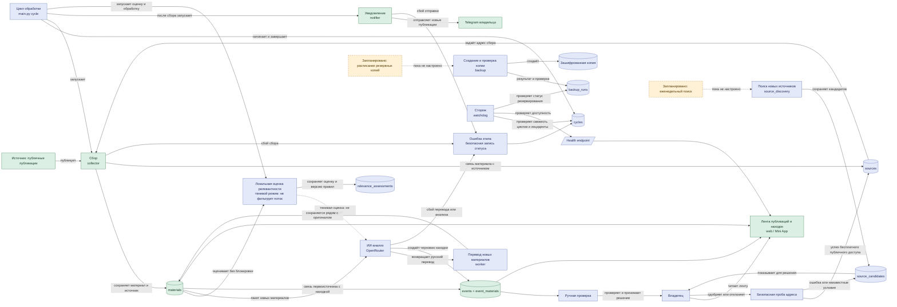

# Поток данных проекта

Диаграмма показывает обработку публикации до находки и смежные процессы наблюдения, резервирования и проверки источников. Локальная оценка выполняется в теневом режиме и не фильтрует поток: все новые материалы идут в ИИ-анализ. Перевод сохраняется из ответа ИИ вместе с результатами анализа. Статусы относятся к коду в рабочей ветке; наличие кода не означает, что расписания или серверное развёртывание включены.

## Статусы и границы

- **Реализовано** — компонент и связи присутствуют в коде проекта.
- **В этой ветке** — функции задач 3 и 6–9 находятся в текущей рабочей ветке; задачи 1–5 входят в её базу. Эта ветка не означает, что изменения уже объединены или развёрнуты.
- **Запланировано** — код команды резервирования и поиска источников существует, но ежедневное/ежемесячное и еженедельное расписания в среде размещения не настроены. Пунктир показывает отдельный запуск, а не часть `cycle`.
- Находки остаются черновиками до ручной проверки владельцем. Сторож фиксирует инциденты и сообщает о сбоях; он не исправляет данные и не принимает продуктовые решения.
- Диаграмма не содержит адресов инфраструктуры, реквизитов доступа или содержимого публикаций.
